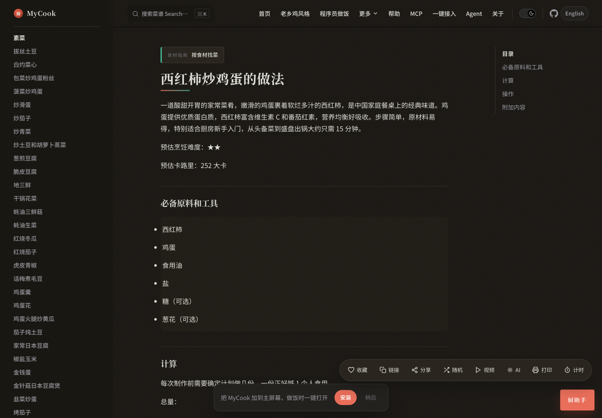

# MyCook 🍳

<p align="center">
  🌐 <a href="./README.md">简体中文</a> · <a href="./README.es-ES.md">Español</a>
</p>

> **打开就能做饭。** 709 道家常菜一站查阅——问一句「今天吃什么」、开冰箱看手头食材能做什么、做菜时开多计时器，还能把菜谱交给 AI。
>
> *Cook 709 Chinese home recipes in one place — ask "what to eat today", match by what's in your fridge, with PWA + MCP Server for AI agents.*

<p align="center">
  <a href="https://cook.alexander.xin">🍳 在线体验（无需安装）</a> ·
  <a href="#快速开始">自部署</a> ·
  <a href="./MCP.md">Agent / MCP</a>
</p>

**首页 · 今天吃什么 / 开冰箱反查 / 一周菜单**


**厨助手：检索优先的厨房 AI，问一句就出菜谱链接**


**菜谱页：难度星级、精确到克与秒、收藏 / 计时器 / 打印**



<p align="center">
  <a href="https://github.com/AlexanderJ-Carter/MyCook/actions/workflows/sync-and-build.yml"></a>
  <a href="https://github.com/AlexanderJ-Carter/MyCook/actions/workflows/docker.yml"></a>
  <a href="https://github.com/AlexanderJ-Carter/MyCook/actions/workflows/pr-check.yml"></a>
  <a href="https://github.com/AlexanderJ-Carter/MyCook/releases"></a>
  <a href="https://github.com/AlexanderJ-Carter/MyCook/blob/main/LICENSE"></a>
  
  <a href="https://github.com/AlexanderJ-Carter/MyCook/pkgs/container/mycook"></a>
</p>

---

## 这是什么

[MyCook](https://cook.alexander.xin) 把两个成熟的开源菜谱项目合并成一张「厨房桌面」，并补上现代 Web 的全部体验：搜索、PWA 离线、周菜单、计时器、AI Agent。上游每天更新菜谱，本站每天自动同步发布。

| 来源 | 入口 | 特点 |
|------|------|------|
| [CookLikeHOC](https://github.com/Gar-b-age/CookLikeHOC) | 按**做法** | 炒、炖、卤、汤…步骤详尽，老乡鸡同款家常味 |
| [HowToCook](https://github.com/Anduin2017/HowToCook) | 按**食材** | 荤素水产、难度星级、精确到克与秒、技巧库 |
| [HowToCook 图片版](https://github.com/king-jingxiang/HowToCook) | `/howtocook-images/` | 4K 配图浏览（可选构建） |
| [Cook 食用手册](https://github.com/YunYouJun/cook) | 开冰箱 | 食材 CSV 轻量集成（~90KB） |

当前规模：**709 道菜谱** · **18 篇技巧** · **599 条食材反查**（构建时自动同步）

---

## 功能一览

**不知道吃什么？**
- 问**厨助手**（快捷键 `A`）：「今天吃什么」「冰箱里有鸡蛋和番茄能做什么」，检索优先、AI 润色，直接给出可点的菜谱链接
- **开冰箱**反查：勾选手头食材，匹配合适的菜（599 条食材搭配）
- **今日推荐**（每日种子）· **转一转**随机 · **一周菜单**规划

**做菜的时候**
- 菜谱页自带**收藏 · 多计时器 · 打印**（打印样式专门优化过）
- 难度星级、精确到克与秒的步骤；`Ctrl+K` 站内搜索
- **复制给 AI**：一键把整道菜谱打包成 prompt，去任何聊天 AI 里追问替换食材/火候

**喜欢折腾？**
- **PWA** 可安装到手机/桌面主屏，离线可看
- **MCP Server**：Cursor / Claude Desktop / Copilot 等 Agent 直接查菜谱（`/mcp` + `/ask`）
- 深色模式 · 无障碍快捷键 `?` · 每日自动同步上游 · Docker 一行命令自托管

<details>
<summary>⚙️ 技术形态速览</summary>

| 类别 | 能力 |
|------|------|
| 找菜 | 站内搜索 `Ctrl+K` / `/` · 三种入口 · 快捷货架 |
| 玩厨房 | **开冰箱**食材反查 · **转一转**随机 · **一周菜单**（localStorage） |
| 学技巧 | **厨房技巧速查**（HowToCook tips 索引） |
| 做菜 | 收藏 · 多计时器 · 打印 · B 站搜视频 · **复制给 AI** |
| 体验 | 深色模式 · PWA 可安装 · 无障碍快捷键 `?` |
| Agent | OpenAPI · Agent Skills · Markdown 镜像 · **MCP Server** · WebMcp |
| 运维 | 每日上游同步 · GHCR 镜像 · 一键安装脚本 |

</details>

<details>
<summary>📂 项目结构</summary>

```
MyCook/
├── .github/workflows/     # CI：Pages / Docker / Release / PR
├── .vitepress/theme/      # Vue 主题与首页组件
├── mcp/server.mjs         # MCP Server（stdio + HTTP）
├── scripts/               # 同步、生成、校验、安装
├── Dockerfile             # nginx + 静态 dist（lite/full）
├── Dockerfile.mcp         # MCP sidecar（可选）
└── docker-compose.yml     # lite / full / dev / agent
```

菜谱正文目录 `cooklikehoc/`、`howtocook/` 由 CI 克隆上游生成，不入库。

</details>

---

## 快速开始

### 在线使用

- **[cook.alexander.xin](https://cook.alexander.xin)** — GitHub Pages CDN 主站（轻量）
- **[mycook.alexander.xin](https://mycook.alexander.xin)** — Cloud 完整站（含 HowToCook 图片版）
- **[cook-mcp.alexander.xin](https://cook-mcp.alexander.xin)** — 厨助手 `/ask` + MCP（两边共用）

同一套 MyCook 应用，不是两个产品。

### 本地开发

```bash
git clone https://github.com/AlexanderJ-Carter/MyCook.git
cd MyCook && npm install

# 需上级目录有 CookLikeHOC / HowToCook，或设环境变量指向路径
npm run sync
npm run docs:dev          # http://localhost:5173
```

### 校验与构建

```bash
npm run generate          # stats / index / tips / agent 发现
npm run validate          # 冒烟测试 JSON + MCP 工具
npm run docs:build:fast   # 快速构建（跳过图片版）
npm run docs:build        # 完整构建（含图片版）
```

---

## 部署

### GitHub Pages（推荐 Fork 部署）

1. Fork 本仓库
2. **Settings → Pages → Source** 选 **GitHub Actions**
3. 推送 `main` → 自动 **Sync & Build** 发布

### Docker（自托管 / Agent）

```bash
# 最快：拉取官方轻量镜像
./scripts/install.sh
# Windows: .\scripts\install.ps1

# 或 CLI
npm run mycook -- docker:pull
npm run mycook -- docker:lite     # 本地构建 lite
npm run mycook -- docker:full     # 含图片版
```

| 镜像 | 标签 | 说明 |
|------|------|------|
| 站点 lite | `:latest` `:lite` | ~600MB 静态站，日常推荐 |
| 站点 full | `:full` | + 图片版子站（Actions 手动构建） |
| MCP | `mycook-mcp:latest` | Streamable HTTP，`:3001/mcp` |

```bash
docker pull ghcr.io/alexanderj-carter/mycook:latest
docker run -d -p 8080:80 --name mycook ghcr.io/alexanderj-carter/mycook:latest

# 可选 MCP sidecar
docker compose --profile agent up -d --build
```

详见 [DOCKER.md](./DOCKER.md) · 镜像清单：`/image-manifest.json`

---

## CI / 发布流程

| 工作流 | 触发 | 作用 |
|--------|------|------|
| [Sync & Build](.github/workflows/sync-and-build.yml) | push `main` · cron · 手动 | 同步 → 构建 → Pages |
| [Docker](.github/workflows/docker.yml) | push tag `v*` · 手动 | 构建并推送 GHCR 镜像 |
| [Release](.github/workflows/release.yml) | push tag `v*` | 创建 GitHub Release |
| [PR Check](.github/workflows/pr-check.yml) | PR → `main` | 语法检查 · validate · 构建 |

**发版步骤**（维护者）：

```bash
# 1. 更新 package.json 版本与 CHANGELOG.md
# 2. 提交 push main（自动部署 Pages）
# 3. 打 tag 触发 Release + Docker 镜像
git tag v1.6.1 && git push origin v1.6.1
```

---

## Agent / MCP

面向 **任意 MCP 客户端**（Cursor、Claude Desktop、Copilot、Windsurf、Cline 等）及 HTTP/OpenAPI 集成：

```bash
npm run generate
npm run mcp          # stdio（合并 mcp/mcp-config.example.json）
npm run mcp:http     # http://127.0.0.1:3001/mcp
```

| 能力 | GitHub Pages | Docker |
|------|:------------:|:------:|
| JSON / OpenAPI / Skills | ✅ | ✅ |
| `Accept: text/markdown` | ❌ | ✅ |
| MCP HTTP sidecar | ❌ | ✅ |

文档：[MCP.md](./MCP.md) · [INTEGRATIONS.md](./INTEGRATIONS.md) · 站点 [/ai-agents](https://cook.alexander.xin/ai-agents)

---

## 环境变量

| 变量 | 说明 |
|------|------|
| `COOKLIKEHOC_PATH` / `HOWTOCOOK_PATH` | 上游仓库本地路径 |
| `SKIP_IMAGES=1` | 跳过图片版 |
| `SKIP_INTEGRATIONS=1` | 跳过食用手册 CSV 同步 |
| `MYCOOK_DATA` | MCP 数据目录（默认 `./public`） |
| `MCP_PORT` | MCP HTTP 端口（默认 3001） |
| `SYNC_PULL=0` | 同步时不 pull 上游 |

---

## 同步机制

- **自动**：push `main` 或每天 10:00（北京）从 fork 拉取最新菜谱
- **手动**：Actions → **Sync & Build** → Run workflow
- **改菜谱**：到 [CookLikeHOC](https://github.com/AlexanderJ-Carter/CookLikeHOC) / [HowToCook](https://github.com/AlexanderJ-Carter/HowToCook) fork 推送，等下次同步
- **改站点功能**：直接改 MyCook 本仓库

---

## 故障排查

| 现象 | 处理 |
|------|------|
| `Get Pages site failed` | Settings → Pages → Source 选 **GitHub Actions** |
| 图片版 404 | 查看 `build-howtocook-images` 日志；或 `SKIP_IMAGES=1` |
| 开冰箱无数据 | 构建需联网同步 CSV；本地 `npm run sync:integrations` |
| 自定义域名 | CNAME → `alexanderj-carter.github.io` |

---

## 致谢

- [HowToCook](https://github.com/Anduin2017/HowToCook) — Anduin2017 及社区
- [CookLikeHOC](https://github.com/Gar-b-age/CookLikeHOC) — Gar-b-age
- [HowToCook 图片版](https://github.com/king-jingxiang/HowToCook) — king-jingxiang
- [Cook · 食用手册](https://github.com/YunYouJun/cook) — YunYouJun（MIT，仅 CSV 集成）

## 贡献者

MyCook 的站点功能由以下贡献者与上游作者共同维护，谨致谢意：

- **[AlexanderJ-Carter](https://github.com/AlexanderJ-Carter)** — 站点主体、MCP、CI/CD
- **[WebBrain](https://github.com/webbrain-one)** — [西班牙语 README](./README.es-ES.md) 翻译

本项目亦借助 GitHub Copilot、Codex 与 Claude 协助开发。

完整名单见 [GitHub Contributors](https://github.com/AlexanderJ-Carter/MyCook/graphs/contributors)。欢迎你的加入——见 [贡献指南](./CONTRIBUTING.md)。

## 许可证

MIT License · 菜谱内容版权归各原作者所有

## 更多

- [CHANGELOG.md](./CHANGELOG.md) · [GitHub Releases](https://github.com/AlexanderJ-Carter/MyCook/releases)
- [CONTRIBUTING.md](./CONTRIBUTING.md) · [AGENTS.md](./AGENTS.md)（维护者）
